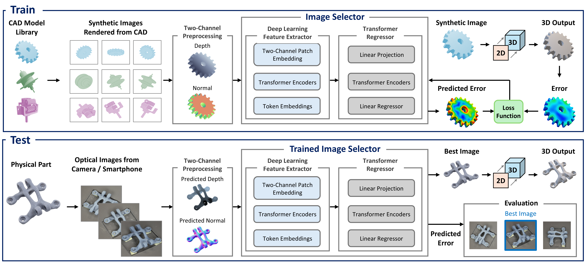

# Single-Image 3D Manufacturing Inspection

This repository contains the data-processing, image-selection, registration, and analysis code for the paper:

> **Deep Learning Enables 3D Manufacturing Inspection from a Single Image**
> Hossein Kabir, Miles V. Bimrose, Charles T. Whealton, Christopher H. Conway, Austin F. Martin, Asif Rashid, Weixuan Zheng, William P. King
> *Grainger College of Engineering, University of Illinois Urbana-Champaign*

## Overview

Manufacturing inspection requires physically accurate measurements of mechanical objects, but dense 3D measurement typically requires slow and costly optical scanning. This work introduces a deep learning method that creates physically accurate 3D digital twins from a single image. A learned Image Selector predicts the 3D reconstruction error of each candidate image from a two-channel geometric representation (depth map + camera-facing surface-normal component), ranks the candidates, and forwards only the lowest-predicted-error image to a 2D-to-3D reconstruction model. Trained entirely on 488,400 synthetic images rendered from 3,700 CAD models, the method achieves average measurement accuracy of 71 µm for digital-camera photographs and 164 µm for smartphone photographs and videos across 50 physical parts, in about 12 s per part.



**Figure | Deep learning method for accurate 3D reconstruction using intelligent view selection.** The Image Selector is trained on synthetic depth-normal inputs rendered from CAD models with measured volumetric-error supervision. During inference, the trained model ranks candidate images of real physical parts by predicted reconstruction error and selects the lowest-error image for 2D-to-3D reconstruction.

## Repository Structure

```
.
├── depth_normal_predictor.ipynb   # Depth and surface-normal map prediction for candidate images
├── image_selector.ipynb           # Image Selector evaluation and per-part image ranking
├── icp_alignment.ipynb            # Coarse + similarity-ICP registration and volumetric-error report
├── latent_space.ipynb             # Latent-space analysis (PCA, t-SNE, K-means) of ranked views
├── assets/
│   ├── fig1.png                   # Method overview (Fig. 1 of the paper)
│   └── video2_drone.gif           # Smartphone-video reconstruction workflow (Supplementary Video 2)
├── input/                         # Place candidate images / reference meshes here (not tracked)
├── caches/                        # Precomputed target caches (.npz) for selector evaluation
├── checkpoints/                   # Trained Image Selector checkpoint (TorchScript)
└── outputs/                       # Generated depth/normal maps, rankings, figures, reports
```

## Dataset

A representative subset of the synthetic and physical-part image datasets used in this study is publicly available on Kaggle:

**[Dataset link — add Kaggle URL here]**

The subset includes:

- Synthetic 2D views rendered from CAD models over the 132-position azimuth-polar pose grid (12 azimuth × 11 polar angles), with co-registered depth and surface-normal maps
- Digital-camera photographs of small physical parts acquired on the robotic stage at the same 132 rotational positions
- Smartphone photographs and video frames of large physical parts
- Reference geometries and reconstructed meshes for registration and volumetric-error evaluation

## Pipeline

The workflow runs in three stages. Each notebook is self-contained and configured through the path constants at the top of its first cell.

### Stage 1 — Geometry-map prediction (`depth_normal_predictor.ipynb`)

Converts each candidate image into the two-channel geometric representation used by the Image Selector. Pretrained monocular depth and surface-normal estimators predict per-pixel geometry, a foreground mask is derived from the alpha channel or near-white background, and masked depth and normal maps are written to `outputs/` with a white background, one `depth/` and one `normal/` folder per part.

### Stage 2 — Image ranking and evaluation (`image_selector.ipynb`)

Loads the trained Image Selector (a self-contained TorchScript checkpoint in `checkpoints/`) and the precomputed target caches in `caches/`. Builds the 2 × 224 × 224 depth-normal input for every candidate image, predicts a scalar reconstruction-error score, reports R², MAE, and MSE against measured volumetric-error labels for the train/validation/test splits, and writes per-part image rankings (rank 1 = lowest predicted error = selected best image). Splits are grouped by CAD model so that all 132 views of a model stay in the same split.

### Stage 3 — Registration and analysis

- `icp_alignment.ipynb` — registers each 3D reconstruction to its reference mesh using centroid-based coarse alignment (cube-root volume scaling) followed by similarity ICP refinement over multiple initializations (identity, PCA-frame with sign-flip variants, and axis rotations). Reports the volumetric error |V_ref − V_rec| / V_ref for the lowest-residual alignment and renders the three-row alignment overlay figure.
- `latent_space.ipynb` — projects pooled Image Selector features with PCA (≤ 50 components) and t-SNE (perplexities 10 and 50), clusters with K-means (k = 8), and saves colored scatter plots comparing depth-only and depth-plus-normal inputs.

## Requirements

```
torch
torchvision
transformers
diffusers
accelerate
opencv-python
pillow
numpy
pandas
scikit-learn
matplotlib
trimesh
rtree
```

Tested with Python 3.12. A CUDA-capable GPU is strongly recommended: geometry-map prediction runs a diffusion-based surface-normal estimator per image, and Image Selector evaluation batches 256 images at 224 × 224. CPU execution works but is slow.

## Smartphone-Video Reconstruction Workflow


**Video .** Reconstruction workflow for the Drone: input smartphone frames, estimated depth and surface-normal maps, frame-by-frame predicted reconstruction accuracy, selected best frame, resulting 3D reconstruction, and comparison with the reference geometry.

## Usage

1. Download the dataset from Kaggle and extract it into `input/`.
2. Place the trained Image Selector checkpoint in `checkpoints/` and the target caches in `caches/`.
3. Run `depth_normal_predictor.ipynb` to generate depth and normal maps for the candidate images.
4. Run `image_selector.ipynb` to score and rank the candidate images; rankings and metrics are written to `outputs/`.
5. Run `icp_alignment.ipynb` to register reconstructions to reference meshes and compute volumetric error.
6. Run `latent_space.ipynb` to reproduce the latent-space analysis.

To run a notebook from the command line:

```bash
jupyter nbconvert --to script depth_normal_predictor.ipynb
python depth_normal_predictor.py
```

## Citation

If you use this code or data, please cite:

```bibtex
@article{kabir2026singleimage,
  title   = {Deep Learning Enables 3D Manufacturing Inspection from a Single Image},
  author  = {Kabir, Hossein and Bimrose, Miles V. and Whealton, Charles T. and
             Conway, Christopher H. and Martin, Austin F. and Rashid, Asif and
             Zheng, Weixuan and King, William P.},
  journal = {[journal, to be updated upon publication]},
  year    = {2026}
}
```

## Contact

Corresponding author: William P. King (wpk@illinois.edu)
